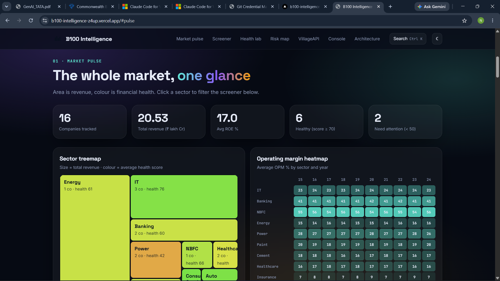
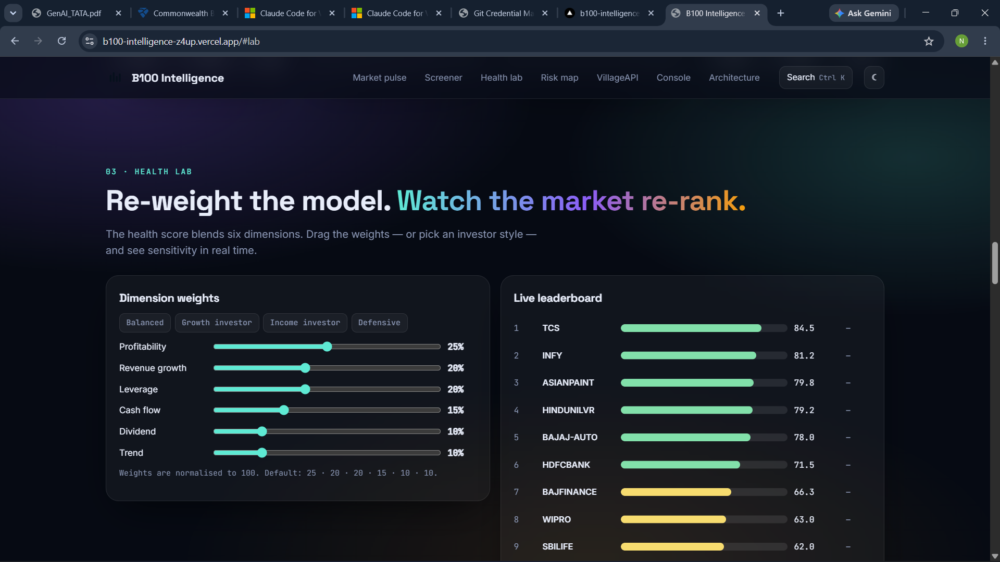
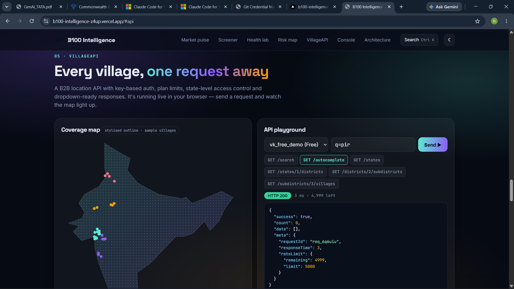
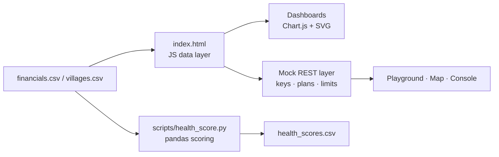

# B100 Intelligence

**Interactive fundamental-analysis dashboard for Nifty-100-style companies, plus a village-level location REST API demo.**

> All financial figures and village records in this repository are **synthetic sample data** generated for demonstration. They are not real market or census data and nothing here is financial advice.

**Live demo:** https://b100-intelligence.vercel.app &nbsp;·&nbsp; **Stack:** HTML · CSS · vanilla JavaScript · Chart.js · Python (pandas) · Vercel







## What it does

| Module | What you can do |
|---|---|
| **Market pulse** | Sector treemap (area = revenue, colour = average health), operating-margin heatmap, aggregate revenue / profit trend |
| **Screener** | Search, filter and sort companies; open a deep-dive panel with 10-year charts, auto-generated strengths and watch-outs, a labelled trend forecast and similar-company peers |
| **Health lab** | Re-weight the six scoring dimensions with sliders or investor-style presets and watch the leaderboard re-rank live |
| **Risk–return map** | Bubble chart with selectable axes (leverage, ROE, margin, growth, payout, score); click a bubble to open the company |
| **VillageAPI** | In-browser mock of a B2B location API: API keys, plan-based state access, 401/403/404/400 errors, autocomplete, and a map that highlights matched villages |
| **Admin console** | Request volume, demand by state, customer plans and a live request log |

## Health score methodology

A 100-point composite, implemented twice (JavaScript for the dashboard, Python for analysis) and cross-checked to within rounding:

| Dimension | Points | Rule |
|---|---|---|
| Profitability | 25 | Percentile rank of the mean of OPM %, net margin % and ROE % |
| Revenue growth | 20 | 3-year sales CAGR (0 if ≤ 0; up to 5 pts below 5 %; capped at 20) |
| Leverage | 20 | Full marks if D/E ≤ 0.1, zero if D/E ≥ 2, linear in between |
| Cash flow | 15 | 5-year mean of operating cash flow ÷ net profit (1.2× = full marks) |
| Dividend | 10 | 5-year mean payout (30 % = full marks) |
| Trend | 10 | Normalised 5-year slope of sales and profit |

Bands: **85+ Excellent · 70–84 Good · 50–69 Average · 35–49 Weak · < 35 Poor**.

**Peer similarity** uses cosine similarity over z-scored vectors of six ratios (OPM, ROE, 3-year growth, D/E, cash conversion, payout).

**Forecast** is a linear fit on the last five years of sales, shown only as a model estimate.

## Architecture



## Run it

```bash
git clone https://github.com/nishant9334/b100-intelligence.git
cd b100-intelligence
python -m http.server 8000      # then open http://localhost:8000
```

No build step: `index.html` is self-contained apart from Chart.js and Google Fonts from CDNs.

**Python scoring + tests**

```bash
pip install -r requirements.txt
python scripts/health_score.py --out data/sample/health_scores.csv
pytest -q
```

## Deployment
The site is a static page deployed on Vercel. Every push to `main` triggers a new deployment automatically. `vercel.json` tells Vercel to serve `index.html` as a static site.

## Mock API reference

Header: `X-API-Key`. Demo keys: `vk_pro_demo` (all states), `vk_free_demo` (Gujarat only).

| Endpoint | Purpose |
|---|---|
| `GET /states` | States visible to the key's plan |
| `GET /states/{id}/districts` | Districts of a state (403 if the plan excludes it) |
| `GET /districts/{id}/subdistricts` | Sub-districts of a district |
| `GET /subdistricts/{id}/villages` | Villages with full hierarchy and `fullAddress` |
| `GET /search?q=&state=&district=&limit=` | Village search |
| `GET /autocomplete?q=` | Typeahead (min. 2 characters) |

Error shape: `{ "success": false, "error": { "code": "ACCESS_DENIED", "message": "…" } }`.

## Repository layout

```
index.html                  # the whole interactive site
data/sample/                # companies, 10-year financials, villages, computed scores (all synthetic)
scripts/health_score.py     # pandas implementation of the scoring model
tests/test_health_score.py  # bounds, labels and edge-case tests
docs/RESUME.md              # resume bullets, LinkedIn text, interview prep
vercel.json                 # Vercel static-site config
```

## Limitations and roadmap

- Data is synthetic; swapping in real filings means replacing the CSVs in `data/sample/` (same columns).
- The API is a browser-side mock. **Planned:** PostgreSQL star schema, Django REST Framework with Swagger docs, Celery for scheduled re-scoring, and Power BI dashboards.
- Bank and NBFC balance sheets do not fit a generic D/E threshold; a sector-specific leverage rule is a planned improvement.

## License

MIT — see [LICENSE](LICENSE).
